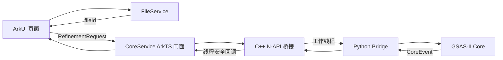

# GSAS-II 鸿蒙桌面核心接口契约

状态：`v1.0`，第三阶段 MVP 的冻结接口。未经集成负责人批准，不得直接修改字段语义；兼容新增字段使用次版本，破坏性修改使用新主版本。

## 1. 目标与边界

本契约规定 ArkUI、应用文件服务、C++ N-API 桥接层和嵌入式 Python/GSAS-II 核心之间的通信方式。第一版只承诺单任务、无 GUI 的粉末精修流程；当前已验证的 recipe 为 `powder-five-stage-v1`。

界面不得直接访问 Python 对象或 GSAS-II 模块，Python 核心不得直接处理系统文件选择器 URI。跨层业务数据统一使用 UTF-8 JSON，文件通过 `fileId` 引用。



## 2. 组件责任

| 组件 | 责任 | 禁止事项 |
|---|---|---|
| ArkUI | 收集参数、调用服务、展示进度/结果/错误 | 直接拼接沙箱绝对路径；解析 Python traceback |
| FileService | 导入用户文件、生成 `fileId`、解析应用内路径、管理输出文件 | 把临时 URI 直接交给 Python；接受 `..` 逃逸路径 |
| CoreService | 参数校验、任务状态、事件订阅、取消、快照 | 在 UI 线程执行 Python；吞掉终态事件 |
| C++ N-API | 嵌入 CPython、线程切换、JSON 转发、生命周期管理 | 向 UI 暴露 `PyObject*`；并行进入同一 Python 解释器 |
| Python Bridge | 解析请求、调用 GSAS-II、生成统一事件和产物 | 读取未由 FileService 授权的路径；修改接口字段 |

## 3. ArkTS 公共接口

```ts
export interface CoreService {
  initialize(config: CoreConfig): Promise<CoreInfo>;
  startRefinement(request: RefinementRequest): Promise<JobAccepted>;
  cancelJob(jobId: string): Promise<CancelAck>;
  getJobSnapshot(jobId: string): Promise<JobSnapshot>;
  onEvent(listener: (event: CoreEvent) => void): () => void;
}

export interface FileService {
  importFile(sourceUri: string, role: FileRole): Promise<AppFile>;
  getFile(fileId: string): Promise<AppFile>;
  deleteFile(fileId: string): Promise<void>;
  exportFile(fileId: string, destinationUri: string): Promise<void>;
}
```

`onEvent` 返回取消订阅函数。页面必须先订阅事件，再调用 `startRefinement`。`initialize` 幂等，应用进程内可以重复调用，但配置不一致时返回 `CORE_ALREADY_INITIALIZED`。

### 3.1 CoreConfig

由打包负责人提供，不由普通页面构造：

```json
{
  "schemaVersion": "1.0",
  "runtimeRoot": "/data/storage/el2/base/files/runtime",
  "workspaceRoot": "/data/storage/el2/base/files/jobs",
  "outputRoot": "/data/storage/el2/base/files/outputs",
  "maxConcurrentJobs": 1,
  "logLevel": "info"
}
```

三个根目录必须位于应用沙箱内。MVP 的 `maxConcurrentJobs` 固定为 `1`。

### 3.2 CoreInfo

初始化成功后至少返回：

```json
{
  "schemaVersion": "1.0",
  "ready": true,
  "pythonVersion": "3.12.9",
  "gsasCommit": "2b4aba1bc44de63a3da9d4495944c3b99e389399",
  "supportedRecipes": ["powder-five-stage-v1"]
}
```

### 3.3 JobAccepted 与 CancelAck

`startRefinement` 只表示请求已通过同步校验并进入队列，不表示精修完成：

```json
{
  "schemaVersion": "1.0",
  "jobId": "job_20261012_001",
  "state": "queued",
  "acceptedAt": "2026-10-12T13:20:00Z"
}
```

`cancelJob` 是协作式取消，返回 `requested: true` 后仍需等待 `job.cancelled`、`job.failed` 或 `job.completed` 终态事件：

```json
{
  "schemaVersion": "1.0",
  "jobId": "job_20261012_001",
  "requested": true
}
```

## 4. 文件接口

用户通过系统选择器选择文件后，FileService 立即复制到：

```text
files/imports/<fileId>/<原始文件名>
```

并返回：

```json
{
  "fileId": "file_pbso4_xra_001",
  "displayName": "PBSO4.XRA",
  "role": "powder-data",
  "size": 49445,
  "sha256": "CA2DA02FC7E17D2FC912DE22A979F8101BA6140F2E8104F9D3AA64F030CA58BB"
}
```

业务请求只传 `fileId`，不传 URI 或绝对路径。FileService 解析时必须拒绝未知 ID、符号链接逃逸和沙箱外路径。每个任务使用独立目录：

```text
files/jobs/<jobId>/input/
files/jobs/<jobId>/work/
files/jobs/<jobId>/logs/
files/outputs/<jobId>/
```

成功任务保留 `.gpx`、结果 JSON 和用户日志；临时文件在结果持久化后删除。失败或取消任务保留日志，工作目录最迟在下次启动清理。默认不覆盖同名导出文件。

## 5. 精修请求

机器可校验定义见 `contracts/refinement-request.schema.json`，标准示例见 `contracts/examples/refinement-request.json`。

关键规则：

- `schemaVersion` 固定为 `1.0`。
- `jobId` 由 CoreService 生成或确认，全进程唯一；重复 ID 返回 `JOB_ALREADY_EXISTS`。
- 当前 recipe `powder-five-stage-v1` 至少需要一个直方图和一个相文件。
- `cycleCount` 范围为 0～50，默认值由 recipe 决定。
- `overwrite` 默认为 `false`。
- 未识别的 recipe 返回 `UNSUPPORTED_RECIPE`，不能静默降级。

## 6. 事件流

机器可校验定义见 `contracts/core-event.schema.json`。每个事件都有：

- `schemaVersion`：固定为 `1.0`；
- `eventId`：全进程唯一；
- `jobId`：所属任务；
- `sequence`：从 0 开始严格递增；
- `timestamp`：UTC ISO 8601；
- `type`：事件类型；
- `payload`：对应类型的数据。

事件类型：

| 类型 | 用途 |
|---|---|
| `job.accepted` | 请求进入队列 |
| `job.progress` | 阶段或百分比变化 |
| `job.log` | 可展示日志；不得包含密钥、完整用户目录或 Python 对象地址 |
| `job.completed` | 唯一成功终态，包含结果和产物 |
| `job.failed` | 唯一失败终态，包含统一错误 |
| `job.cancelled` | 唯一取消终态 |

每个任务必须且只能产生一个终态事件。终态后不得再发送任何事件。`percent` 必须在 0～100 之间且不能倒退。

当前标准阶段名：

```text
preparing
reading_files
before_fitting
scale_and_background
cells
microstrain_displacement_atoms
preferred_orientation
saving
completed
```

完整成功、失败和取消序列分别见 `contracts/examples/core-events-success.json`、`contracts/examples/core-events-failed.json` 和 `contracts/examples/core-events-cancelled.json`。

## 7. 任务状态机

```text
queued -> validating -> running -> saving -> succeeded
                     \-> cancelling -> cancelled
          \-------------------------> failed
```

`getJobSnapshot` 返回最近状态、最近序号、百分比、阶段和终态摘要。进程重启后，未完成任务统一标记为 `failed`，错误码为 `PROCESS_INTERRUPTED`；MVP 不自动恢复精修。

## 8. Python Bridge 接口

C++ 层只调用以下稳定入口：

```python
initialize(config_json: str) -> str
execute(request_json: str, emit_event, is_cancelled) -> str
```

- `initialize` 返回 `CoreInfo` JSON。
- `execute` 只能在专用工作线程运行。
- `emit_event(event_json)` 每次传递一个符合 CoreEvent Schema 的 JSON 字符串。
- `is_cancelled() -> bool` 在每个阶段开始前和 GSAS-II 可安全中断点调用。
- `execute` 返回最终事件 JSON，且该 JSON必须与最后一次 `emit_event` 的终态完全一致。
- Python traceback 写入应用私有日志；对 UI 只返回错误码、用户可读消息和经过清理的 detail。

## 9. 错误码

| 错误码 | 场景 | 可重试 |
|---|---|---:|
| `INVALID_REQUEST` | JSON、字段或参数范围错误 | 否 |
| `UNSUPPORTED_SCHEMA` | 接口主版本不支持 | 否 |
| `UNSUPPORTED_RECIPE` | recipe 未实现 | 否 |
| `JOB_ALREADY_EXISTS` | `jobId` 重复 | 否 |
| `CORE_NOT_READY` | Python 或依赖尚未初始化 | 是 |
| `CORE_ALREADY_INITIALIZED` | 重复初始化时配置不一致 | 否 |
| `BUSY` | 已有任务运行 | 是 |
| `FILE_NOT_FOUND` | `fileId` 不存在 | 否 |
| `FILE_HASH_MISMATCH` | 导入后文件发生变化 | 否 |
| `UNSUPPORTED_FILE` | 数据格式不受支持 | 否 |
| `INVALID_INSTRUMENT_FILE` | 仪器参数无法读取 | 否 |
| `INVALID_PHASE_FILE` | CIF/相文件无法读取 | 否 |
| `REFINEMENT_FAILED` | GSAS-II 精修失败 | 视 detail 而定 |
| `OUTPUT_WRITE_FAILED` | 结果无法持久化 | 是 |
| `JOB_NOT_FOUND` | 查询或取消未知任务 | 否 |
| `PROCESS_INTERRUPTED` | 进程退出导致任务中断 | 是 |
| `INTERNAL_ERROR` | 未分类内部错误 | 是 |

未知异常统一映射到 `INTERNAL_ERROR`，但必须记录原始 traceback。错误对象至少包含 `code`、`message`、`retryable`，可选 `detail`；不得把 traceback 填入 `message`。

## 10. 线程、取消与生命周期

- 所有 Python 调用在单一专用工作线程串行执行，ArkUI 主线程只接收 Promise 和事件。
- N-API 使用线程安全函数把事件切回 ArkTS。
- 应用后台化时任务继续运行；应用主动退出且任务未完成时，页面必须提示用户。
- MVP 的取消是阶段边界取消，不承诺中断单个正在执行的 GSAS-II 数值调用。
- C++ 层负责 GIL 获取和释放；ArkTS、UI 或文件线程不得持有 Python 引用。

## 11. 验收条件

接口验收至少包含：

1. 成功示例通过 `scripts/Validate-CoreContracts.py`。
2. 页面在订阅后启动任务，事件序号严格递增，且只收到一个终态。
3. PbSO4 五阶段结果满足 `poc/core_refinement.py` 的既有容差。
4. 未知 `fileId` 返回 `FILE_NOT_FOUND`，无界面崩溃。
5. 第二个并发任务返回 `BUSY`。
6. 取消后最终收到 `job.cancelled`，并可重新启动任务。
7. 输出 `.gpx`、结果 JSON 和日志均可通过 FileService 导出。
8. Python 异常不会终止应用进程，用户界面不展示 traceback。

## 12. 分工与变更控制

- 界面负责人依据 ArkTS 接口和示例实现页面，可在核心未完成时使用成功/失败事件示例作为 mock。
- 核心负责人实现 N-API、Python Bridge 和事件序列。
- 打包/上架负责人实现 FileService、沙箱目录、运行时部署和发布包检查。
- 集成负责人维护本契约、批准字段变更并执行第 11 节验收。

任何字段变更必须同步更新 Schema、示例、校验脚本和本文档；只改其中一处视为接口未完成。
