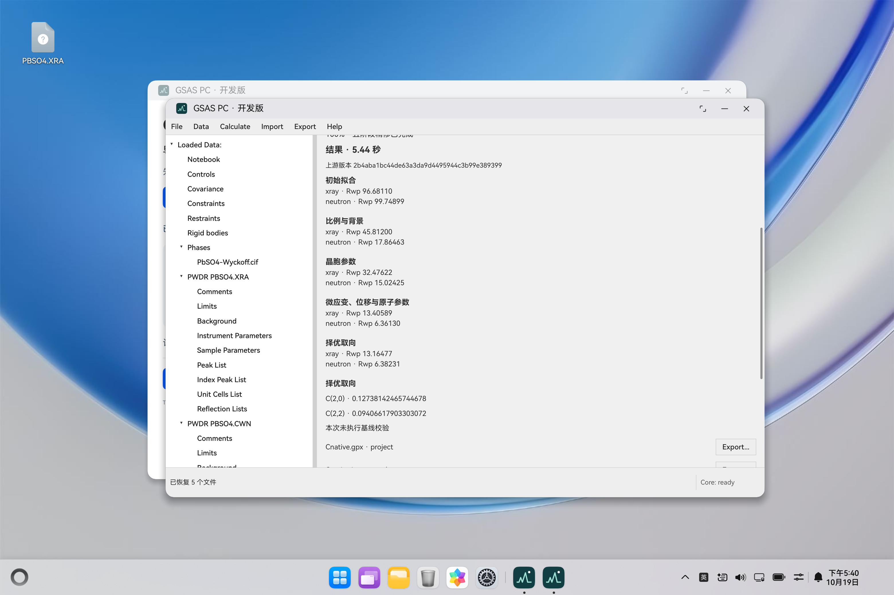

# C：8 扩展、运行时与实际 HAP 验收

2026-10-19，基于 `main@5a4cc39f58c9ed7ad0b102c632f85b0e3c2fa472` 的 C 工作树。
**开发集成已可运行；releaseApproved=false。** 使用 API26 ARM64 的 MateBook Pro 1 模拟器，不能代替 API20/API24 目标真机与正式签名验收。

## 可复建的成果

- 从 GSAS-II `2b4aba1bc44de63a3da9d4495944c3b99e389399` 构建全部 8 个 OHOS ARM64 / CPython 3.12 扩展。原始归档 SHA-256、LLVM 源码 URL/哈希及工具版本在 [sources.lock.json](../scripts/ohos/local-cross/sources.lock.json)。[配方与补丁](../scripts/ohos/local-cross/README.md)在全新上游副本上再次交叉编译通过。
- 本次用 **Flang/LLVM20.1.8**，原 B 设备记录为 20.1.0；FortranRuntime/Decimal 由匹配的 20.1.8 源码交叉编译后静态链接。两个构建应独立复核。DIFFaX 库、pydiffax 生成/编译目标和独立程序在构建前排除，分发树也排除 G2shapes。
- 修复上游 `fmask.c` 在 `return PyModule_Create()` 后才调用 `import_array()` 的问题；实际 NumPy 数组调用已通过。单纯 import 成功无法发现此缺陷。
- `Normalize-PythonNeeded.py` 将 133 个 NumPy/SciPy 消费者的准确 DT_NEEDED 从 `libpython3.12.so.1.0` 改为实际单份解释器 `libpython3.12.so`。输入不可变，在新副本修改后 strip/重签，不添加解释器副本或库名别名。保留运行时依赖的 NumPy `_core/tests/_natype.py`。
- `Stage-NativeRuntime.py` 将 221 个 ELF 放入 HAP 原生目录，生成 141 个 Python 扩展映射。重复装配保留既有映射；记录并恢复空命名空间（SciPy `_propack` 的空目录原本会在 HAP 中消失）。HAP 内原生库字节逐项与冻结清单一致。
- CPython 宿主从实际解释器地址定位安装库目录、加载原生映射，并释放初始化线程的 GIL；CMake 不把临时宿主路径写入 RUNPATH。无运行时的 stub 开发包仍可构建。
- 参数草稿的保存/清空及跨页面展示触发正确刷新；Checkbox 使用当前字段值；修正 Comments 布局和 ArkTS 子组件链接写法。既有 Controls、Notebook、Comments 的保留在同一 HAP 中实测。

## 同一 HAP 的验收

运行时：`c-native-8-zoifhpdn-v2`；bundleName：`com.gsasii.desktop`；开发版本 `0.1.0` / versionCode `1`。

| 项目 | 结果 |
|---|---|
| 构建与安装 | DevEco CLI1.3.5，ArkTS 检查及 Release 模式构建通过；覆盖安装启动成功 |
| 实际包 | 156,149,605 字节；SHA-256 `5dde4d66aaf418f073705964d2d9194366828e0ce97e211b58e8668e2069bae9` |
| 包内容 | 2245 个实际条目；2225 个运行时清单文件；224 个 ELF（221 个运行时及 3 个应用/SDK 库） |
| 核心初始化 | 正式应用进程显示 `Core: ready`，8 模块门禁无 `--allow-missing` 通过 |
| 科学计算 | UI → N-API → 嵌入式 CPython，真实 PbSO4 五阶段成功；约 5.44 秒 |
| 数值核对 | 从应用输出 JSON 独立比较全部五阶段 Rwp：rtol=1e-4、atol=1e-7；择优取向 rtol=1e-3 通过 |
| 系统导出 | 同一成功任务的 GPX/JSON/日志均通过系统保存选择器导出；三个 SHA-256 与应用内产物一致；选择器取消已执行 |
| 取消 | 真实任务在阶段边界协作取消；只显示 cancelled，登记用户取消日志；重启正确恢复 |
| 中断 | 活动任务被终止后重启，显示 failed / PROCESS_INTERRUPTED，不恢复旧计算；没有日志 artifact 时不伪造可导出日志 |
| 数据保留 | 原 5 份输入、Controls 的 `0.0001`、Notebook 多行内容及 XRA Comments 保留；新增文件是验收产物 |
| SBOM | 实际 HAP 逐文件哈希、19 个组件分组、224 个 ELF 动态信息；CycloneDX 官方1.5 Schema 验证通过 |

注意：实际 UI 请求的 `validateAgainstBaseline=false`，因此原始结果仍保留 `validation.performed=false`。上述数值通过来自 C 对**同一应用产物**的独立容差比较，不能将它改写为应用自行执行了基线校验。

[原始应用结果](evidence/member-c-2026-10-19/application-five-stage-result.json)、[独立比较](evidence/member-c-2026-10-19/application-result-comparison.json)、[模块清单](evidence/member-c-2026-10-19/native-modules.json)、[实际 ELF 依赖](evidence/member-c-2026-10-19/hap-native-dependencies.json)、[验收摘要](evidence/member-c-2026-10-19/acceptance.json)、[三类产物导出比对](evidence/member-c-2026-10-19/export-comparison.json)。



## 回归检查与复验

63 项 Python 工具测试通过；Bridge 28 项中 27 通过、1 项因宿主无 GSAS-II 运行时跳过（另有实际 HAP 科学验收）；Node 101 项通过；C++ 核心/排他创建及真实 CPython 跨线程回归通过；固定源码重新交叉编译、集成/无运行时两种 HAP、官方 CycloneDX1.5 Schema 及契约/样例完整性检查通过。CI 增加新工具与跨线程测试。

```sh
python3.13 -m unittest discover -s tests -p 'test_*.py'
python3.13 -m unittest -v bridge.tests.test_python_bridge
python3.13 scripts/payload/check_gsas_native.py --payload PAYLOAD
python3.13 scripts/Write-RuntimeManifest.py --payload PAYLOAD --components components-native.json --runtime-id NEW_ID --output runtime-manifest.json
python3.13 scripts/Build-App.py --check --build-mode release --runtime-manifest runtime-manifest.json --runtime-payload PAYLOAD --output-dir NEW_BUILD_DIR
python3.13 scripts/Build-HapSbom.py --hap FINAL.hap --manifest runtime-manifest.json --native-build-receipt native-modules.json --output NEW_SBOM_DIR
```

运行时 ELF 应在最终签名、布局及 bridge 更新完成后生成清单；entry 的 `nativeLib` strip 排除项应来自本次布局报告，避免 Hvigor 再次改写已签名字节。

## 交接与未关闭门禁

仓库按既有规则只提交源码、配方和紧凑证据，不提交 HAP、运行时二进制、SDK 或签名材料。完整交接目录位于本地仓库忽略的 `app/build/gsas-c-delivery-rfyesdzr/`，包含开发 HAP、最终展开载荷归档、清单/组件/布局、完整逐文件 SBOM 与构建及设备证据。此前本机构建材料位于 `app/build/gsas-native-build-zoifhpdn/`。这两处不是已发布下载链接。

剩余事项：正式签名证书/profile 与适配账号、API20/API24 目标真机、递增 versionCode 的正式升级和获准清除数据后的卸载重装矩阵、许可/第三方范围最终复核、组长技术放行及[发布材料确认](C_LISTING_DRAFT.md)。

静态依赖仍有 `libc.musl-aarch64.so.1`、`libgcc_s.so.1` 两个未匹配名字，来自捆绑 GNU Fortran/OpenBLAS64 帮助库。五阶段实测通过不证明所有附带库及其他算法路径都可用；需依据构建物料核定这些帮助库是否应分发、其版本与许可，并复验所保留路径。开发自签名、`.codesign` 段存在、SBOM 格式正确均不能替代正式签名、完整许可或发布审批。
